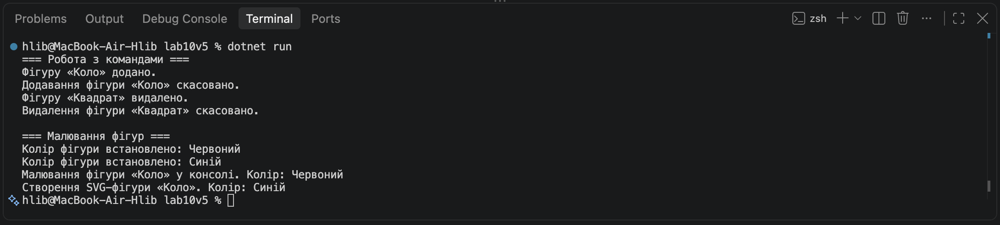

# Лабораторна робота №6

У ході лабораторної роботи №6 я створив інтерфейс ICommand та класи AddShapeCommand і RemoveShapeeComand, що його реалізують. Також розробив абстрактний клас ShapeDrawer та похідні класи ConsoleShapeDrawer і SvgShapeDrawer. За допомогою двох колекцій продемонстрував поліморфізм, виконання команд, скасування дій і малювання фігур різними способами.

