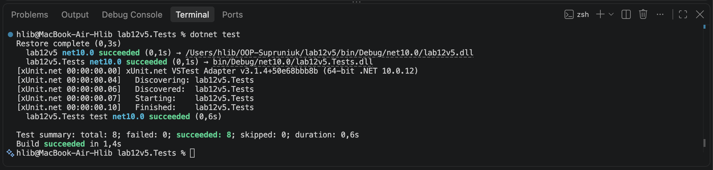

# Лабораторна робота №7

У ході лабораторної роботи №7 я створив інтерфейс IEntity, узагальнений інтерфейс IRepository<T> з обмеженням where T : IEntity та класи InMemoryRepository<T> для виконання CRUD-операцій. Реалізував сутність Customer відповідно до варіанту №5. Створив окремий тестовий проєкт на основі xUnit та написано 8 юніт-тестів для перевірки додавання, отримання, оновлення й видалення даних. Усі тести пройшли успішно.

