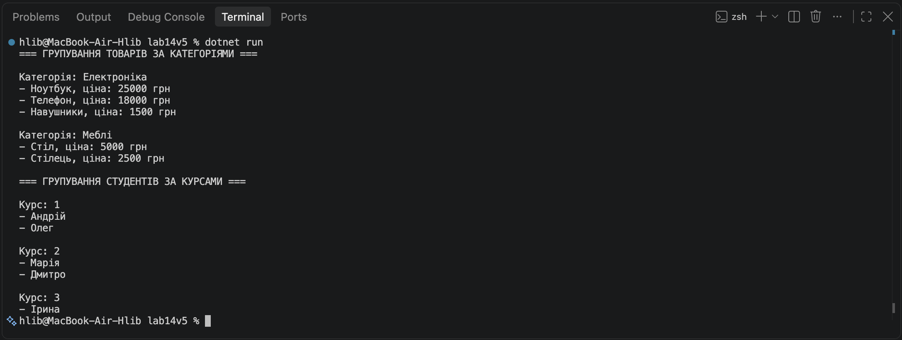

# Лабораторна робота №8

У ході виконання лабораторної роботи №8 я реалізував узагальнений статичний клас CollectionHelper<T> з методом GroupBy<TKey>, який групує елементи колекцій за заданою ознакою за допомогою делегата Func<T, TKey>. Роботу методу показано на двох типах даних: товарах, зрупованих за категорією, та студентах, згрупованих за курсами. Для визначення критеріїв групування використано лямбда-вирази.

