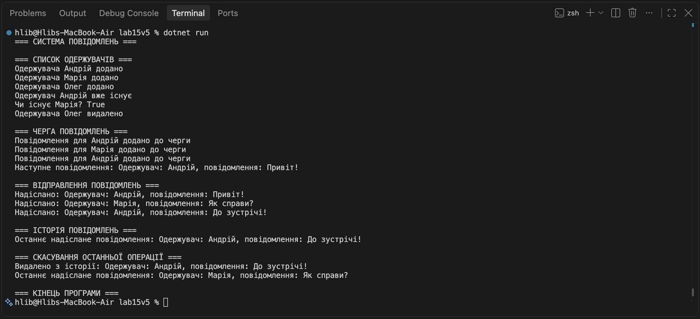

# Лабораторна робота №9

У ході виконання лабораторної роботи №9 я реалізував систему повідомлень із трьох спеціалізованих колекцій C#. HashSet<string> використовується для зберігання унікальних одержувачів, Queue<Message> - для формування черги на відправлення за принципом FIFO, а Stack<Message> - для зберігання історії надісланих повідомлень за принципом LIFO. Продемонстрував додавання, видалення, перевірку наявності одержувачів, відправлення повідомлень та перегляд історії.

