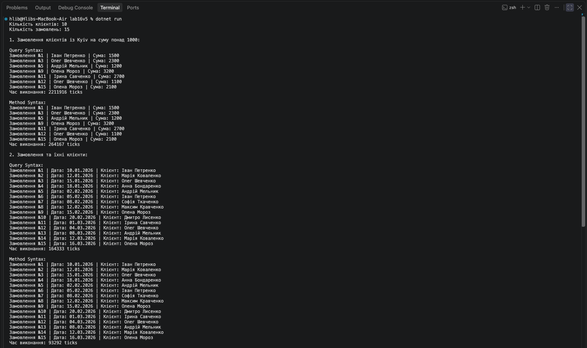
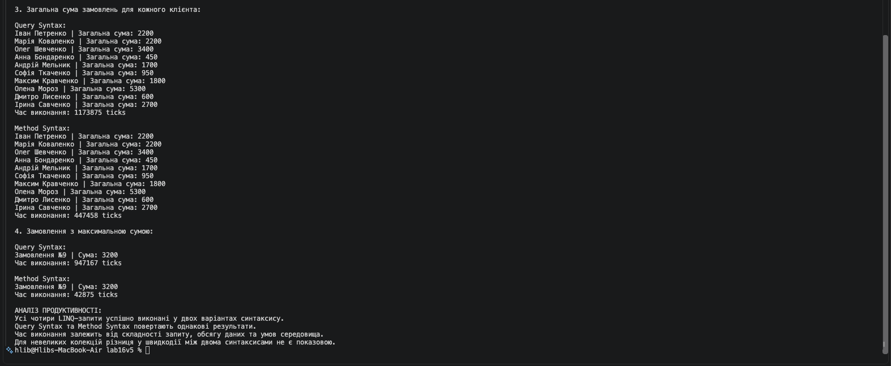

# Лабораторна робота №10

У ході виконання лаборанторної роботи №10 я створив консольний застосунок для управління замовленнями з використанням C#. Реалізував класи Order та Customer, створив тестові колекції клієнтів і замовлень. За допомогою LINQ виконав фільтрацію, об'єднання даних, групування та агрегацію. Усі чотири запити реалізовано у синтаксисах Query Syntax і Method Syntax, а час їх виконання виміряно за допомогою Stopwatch. Провів аналіз результатів та продуктивності запитів.

