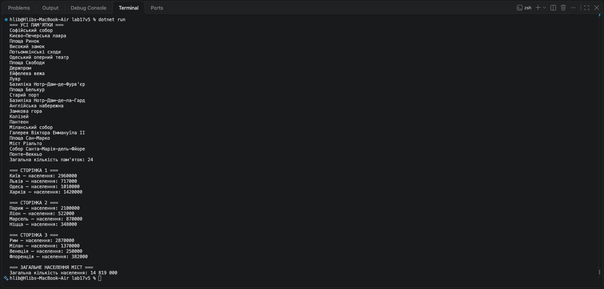

# Лабораторна робота №11

У ході виконання лабораторної роботи №7 я створив програму для роботи з вкладеними колекціями країн, міст і пам’яток. За допомогою LINQ-методу SelectMany реалізував отримання загального списку пам’яток, використав методи Skip() і Take() для пагінації міст по 4 елементи на сторінку, а також створив власний метод розширення TotalPopulation() для обчислення загальної кількості населення всіх міст. Перевірив роботу програми на тестових даних, що містять 3 країни, 12 міст і 24 пам’ятки.

