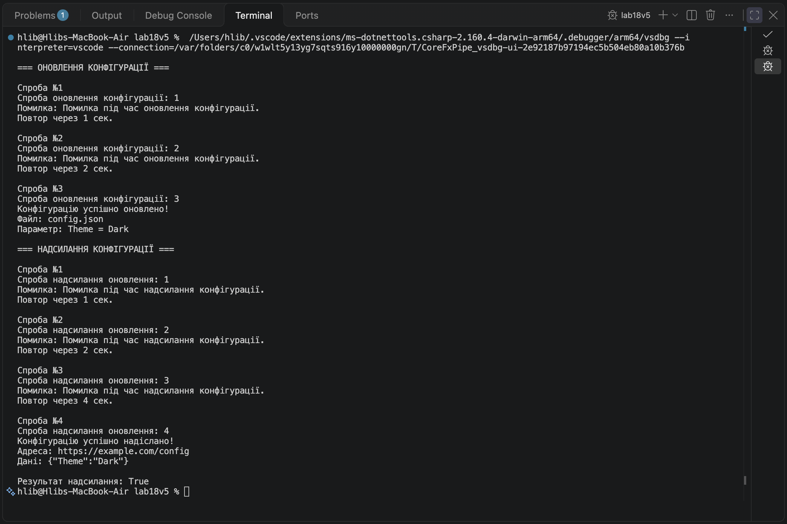

# Лабораторна робота №12

У ході виконання лабораторної роботи №12 я реалізував обробку помилок вводу/виводу та мережевих помилок у C#. Створив класи FileProcessor і NetworkClient для імітації тимчасових помилок під час оновлення конфігурації, а також узагальнений клас RetryHelper з методом ExecuteWithRetry<T>. Реалізував повторні спроби виконання операцій з експоненційною затримкою та використанням делегата shouldRetry для вибіркової обробки винятків.

