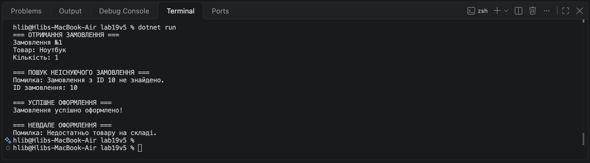

# Лабораторна робота №13

У ході виконання лабораторної роботи №13 я реалізував власний тип винятку OrderNotFoundException для обробки ситуацій, коли замовлення не знайдено. Створив узагальнений клас Result<T> для представлення успішного результату або повідомлення про помилку, а також клас OrderService для пошуку та оформлення замовлень. Перевірив роботу програми за допомогою обробки винятків try-catch та перевірки результатів через IsSuccess і Error.

