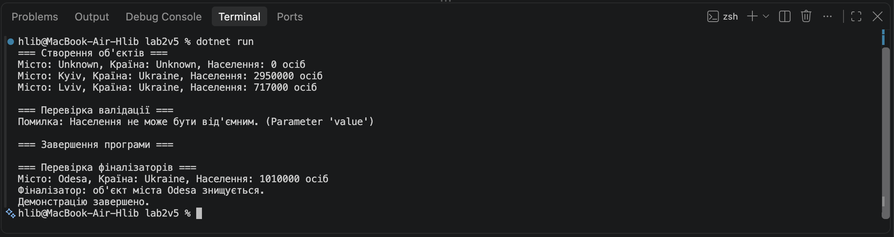

# Звіт з лабораторної роботи №2

У лаборатоорній роботі №2 я реалзував клас City мовою C#. Створив приватні поля та публічні властивості для зберігання назви міста, країни й кількості населення. Реалізував конструктор за замовчуванням, параметризований конструктор, метод GetCityInfo(), перевірку коректності кількості населення та фіналізатор. Перевірив роботу програми шляхом створення обʼєктів, обробки помилки валідації та демонстрації роботи фіналізатора

## Скріншот роботи програми

