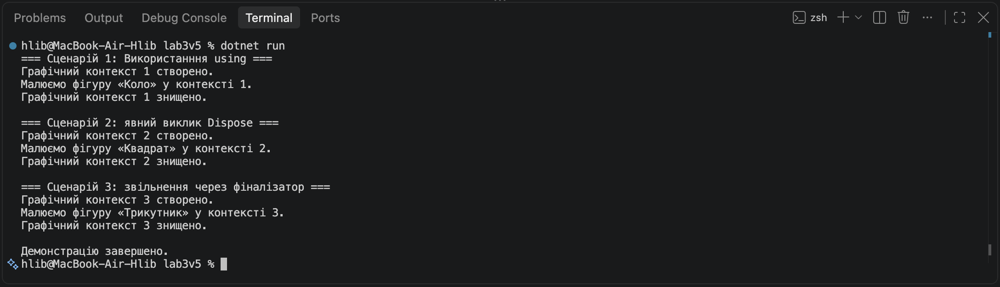

# Звіт з лабораторної роботи №3

У лабораторній роботі №3 я реалізував клас GraphicsContext з інтерфейсом IDisposable для керування життєвим циклом ресурсів. Реалізував методи Dispose() і Dispose(bool disposing), фіналізатор та виклик GC.SuppressFinalize(this). Перевірив роботу трьох сценаріїв звільнення ресурсів за допомогою using, явного виклику Dispose() та фіналізатора.

## Скріншот роботи програми

