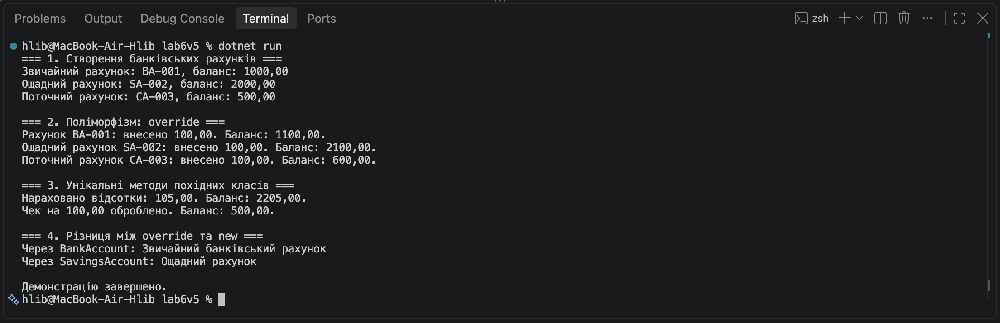

# Звіт з лабораторної роботи №6

У лабораторній роботі №6 я реалізував ієрархію класів BankAccount, SavingsAccount і CheckingAccount. Використав наслідування, конструктори base(...), перевизначення методу Deposit() за допомогою virtual і override, а також приховування методу GetAccountType() за дпомогою new. Продемонстрував роботу поліморфізму, нарахування відсотків і обробку чека.

## Скрішот роботи програми

