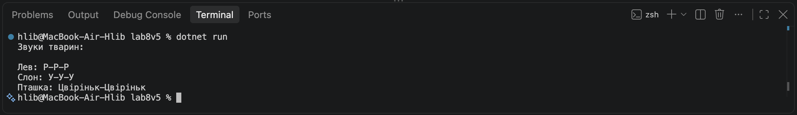

# Лабораторна робота №5

У ході лабораторної роботи №5 я створив ієрархію класів Animal, Lion, Elephant та Bird. Реалізував поліморфізм за допомогою virtual та override, створив колекцію обʼєктів базового класу Animal і виконав агрегацію звуків тварин.

## Скріншот роботи програми

